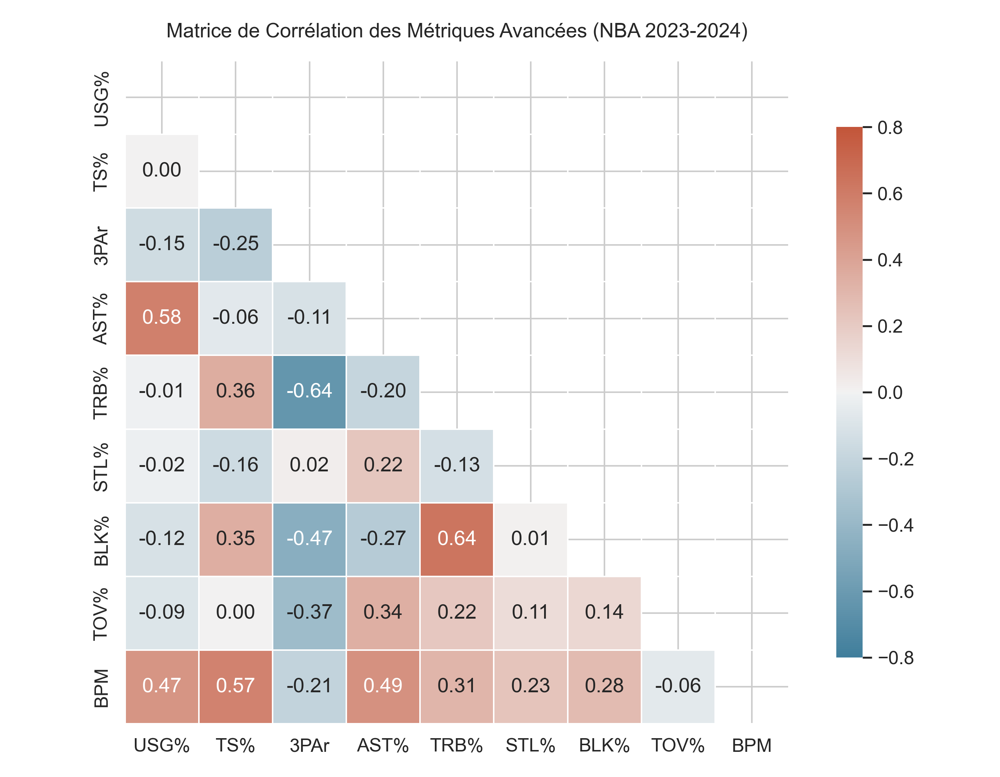
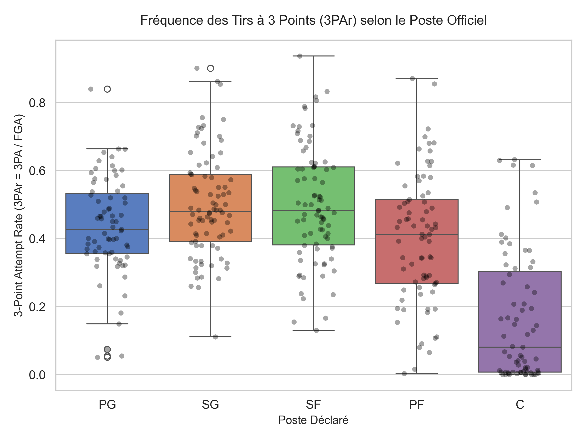
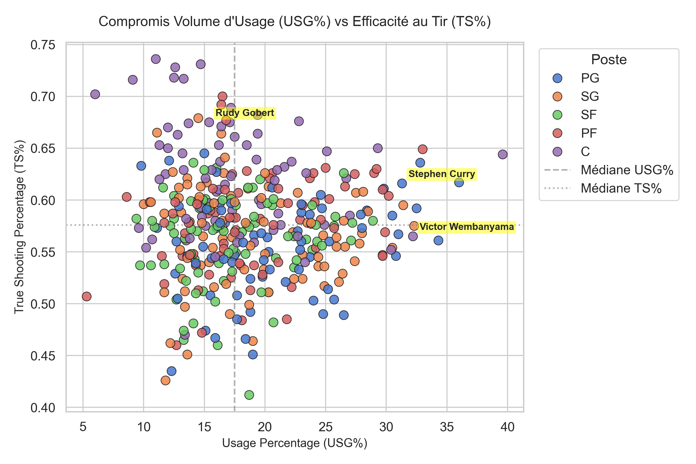

# FICHE DE CADRAGE INTERMÉDIAIRE — PROJET ANDO 2026

**UE :** Analyse de Données (ANDO) — Année Universitaire 2026  
**Thème :** Sport  
**Date de soumission :** Novembre 2026  
**Format :** Note de cadrage méthodologique et descriptive (2-3 pages)

---

## 1. Titre et Introduction

### Titre du Projet
> **La Révolution du Tir à 3 Points et l'Obsolescence des Postes Traditionnels en NBA :  
> Analyse Factorielle et Classification Non Supervisée des Nouveaux Archétypes de Joueurs**

### Introduction & Motivation
Durant plusieurs décennies, le basket-ball professionnel nord-américain (NBA) s'est articulé autour d'une nomenclature stricte à cinq postes : le meneur (*Point Guard* - PG), l'arrière (*Shooting Guard* - SG), l'ailier (*Small Forward* - SF), l'ailier fort (*Power Forward* - PF) et le pivot (*Center* - C). Cette catégorisation reposait sur une division spatiale et morphologique élémentaire : les joueurs de petite taille évoluaient au large pour créer et distribuer le jeu, tandis que les joueurs de grande taille opéraient exclusivement à proximité de la raquette pour capter les rebonds et protéger le cercle.

Néanmoins, depuis l'avènement des *analytics* au milieu des années 2010 (ère du *Pace & Space* et optimisation géométrique de la rentabilité des tirs), la NBA a connu une mutation tactique sans précédent. La valorisation maximale des tirs à 3 points et des finitions au cercle — au détriment des tirs à mi-distance jugés inefficients — a contraint l'ensemble des athlètes, quelle que soit leur taille, à élargir leur registre technique. Dès lors, des intérieurs mesurant plus de 2,10 m mènent les attaques et arrosent à longue distance (ex. Nikola Jokić, Victor Wembanyama), tandis que des arrières captent des rebonds et dictent le tempo. La nomenclature historique des cinq postes apparaît aujourd'hui dépassée pour rendre compte de la réalité fonctionnelle sur le terrain.

### Question Principale de Recherche
> **« À l'ère du tir à 3 points, dans quelle mesure les 5 postes historiques de la NBA sont-ils devenus obsolètes, et quels nouveaux profils de joueurs émergent lorsque l'on analyse leurs données réelles de jeu ? »**

### Sous-Questions Initiales
1. **Sous-question 1 (Inférence & Modélisation)** : La spécialisation spatiale (fréquence de tir à 3 points `3PAr` et création `AST%`) présente-t-elle encore des écarts significatifs entre les cinq postes déclarés, ou observe-t-on une hybridation mesurable ? Quels facteurs expliquent le mieux l'impact global d'un joueur (`BPM`) ?
2. **Sous-question 2 (Méthode Factorielle - ACP)** : Quelles sont les dimensions latentes indépendantes qui structurent l'espace des performances en NBA ? Observe-t-on une simple opposition taille/poste ou des axes fonctionnels transversaux (ex. volume de création vs efficacité de rôle) ?
3. **Sous-question 3 (Clustering Non Supervisé)** : Une classification non supervisée appliquée sur les composantes principales fait-elle émerger des clusters cohérents avec les postes déclarés, ou révèle-t-elle une nouvelle typologie de rôles (ex. *3-and-D*, *Playmaking Big*, *Rim Protector*, *Floor Spacer*) ?

---

## 2. Source des Données, Échantillon et Description des Variables

### 2.1 Origine et Unité d'Observation
Les données sont extraites de la base de référence internationale **Basketball-Reference** pour la saison régulière complète **2023-2024**.
- **Unité d'observation :** Un individu statistique représente **un joueur de la NBA** ayant participé à la saison régulière 2023-2024.
- **Population brute :** 736 enregistrements initiaux (573 joueurs uniques, certains apparaissant plusieurs fois suite à des transferts entre franchises).

### 2.2 Dictionnaire des Variables Sélectionnées

Pour neutraliser le biais mécanique lié au nombre de minutes disputées et au rythme de jeu (*pace*) propre à chaque équipe, nous privilégions des métriques normalisées sur les possessions (*Advanced Stats*) et des ratios de tentative :

| Variable | Type | Unité | Signification & Formule | Rôle dans l'étude |
| :--- | :--- | :--- | :--- | :--- |
| `Player` | Qualitatif | Texte | Nom et prénom du joueur | Identifiant unique |
| `Pos` | Qualitatif | Catégoriel | Poste officiel déclaré (PG, SG, SF, PF, C) | Variable illustrative de référence |
| `Age` | Quantitatif | Années | Âge de l'athlète | Variable de contrôle démographique |
| `MP` | Quantitatif | Minutes | Total de minutes disputées sur la saison | Critère de représentativité ($MP \ge 400$) |
| `USG%` | Quantitatif | Pourcentage | *Usage Percentage* : % de possessions terminées par le joueur en jeu | Intensité d'implication offensive |
| `TS%` | Quantitatif | Pourcentage | *True Shooting %* : $\frac{\text{PTS}}{2 \times (\text{FGA} + 0.44 \times \text{FTA})}$ | Efficacité globale au tir (2pts, 3pts, LF) |
| `3PAr` | Quantitatif | Ratio (0-1) | *3-Point Attempt Rate* : $\frac{\text{3PA}}{\text{FGA}}$ (% de tirs pris à 3 points) | Degré d'extériorisation du tir |
| `AST%` | Quantitatif | Pourcentage | *Assist %* : % de paniers des coéquipiers assistés par le joueur | Capacité de passe et de *playmaking* |
| `TRB%` | Quantitatif | Pourcentage | *Total Rebound %* : % de rebonds disponibles captés sur le parquet | Présence intérieure et contrôle aérien |
| `STL%` | Quantitatif | Pourcentage | *Steal %* : % de possessions adverses conclues par une interception | Activité défensive extérieure |
| `BLK%` | Quantitatif | Pourcentage | *Block %* : % de tirs adverses à 2 points contrés | Dissuasion et protection du cercle |
| `TOV%` | Quantitatif | Pourcentage | *Turnover %* : Pertes de balle pour 100 possessions conclues | Vulnérabilité / prise de risque |
| `BPM` | Quantitatif | Score réel | *Box Plus/Minus* : Points apportés par 100 possessions vs moyenne ligue | **Cible de modélisation (Impact net)** |

---

## 3. Nettoyage, Pré-traitement et Qualité des Données

### 3.1 Nettoyage Réalisé
Le protocole de préparation des données a été implémenté via un script Python dédié (`download_and_clean_data.py`) :
1. **Dédoublonnage des joueurs transférés :** Lorsqu'un joueur change d'équipe durant la saison, la source fournit une ligne par équipe ainsi qu'une ligne agrégée `TOT` (*Total*). Seule la ligne `TOT` est conservée afin d'obtenir la performance consolidée sur l'ensemble de la saison.
2. **Normalisation des postes hybrides :** Les désignations composées (ex. `PG-SG`, `SF-PF`) ont été assignées à leur premier poste principal.
3. **Imputation des valeurs manquantes :** Certains ratios de tirs (`3P%`, `FT%`) présentaient des valeurs manquantes pour les joueurs n'ayant tenté aucun tir dans la catégorie considérée (division par zéro). Ces valeurs ont été rigoureusement imputées à $0.0$.
4. **Filtrage de représentativité ($MP \ge 400$) :** Les joueurs ayant cumulé moins de 400 minutes sur la saison ont été exclus. Ce seuil statistique élimine les artéfacts d'échantillonnage (ex. remplaçants avec 100% de réussite sur un tir en 3 minutes) tout en conservant l'intégralité des 8 à 10 joueurs de rotation principale de chaque franchise.

**Effectif final retenu :** **385 joueurs réguliers**, parfaitement répartis entre les cinq postes historiques :
- **SG :** 84 joueurs (21,8%)
- **SF :** 82 joueurs (21,3%)
- **PF :** 77 joueurs (20,0%)
- **PG :** 71 joueurs (18,4%)
- **C :** 71 joueurs (18,4%)

### 3.2 Limites et Risques Identifiés sur les Données
- **Mesure de la défense :** Les statistiques issues de la feuille de match (*box-score*) sous-estiment intrinsèquement certaines qualités défensives non comptabilisables (la communication, le positionnement dissuasif). L'utilisation conjointe de `BLK%`, `STL%` et du score synthétique `DBPM` permet d'atténuer ce biais.
- **Interactions tactiques et temps de jeu :** Les statistiques individuelles dépendent du système de jeu mis en place par l'entraîneur. L'utilisation exclusive de statistiques ramenées aux possessions (`%`) garantit l'invariance par rapport au rythme d'équipe.

---

## 4. Aperçu Statistique Initial et Premiers Résultats

### 4.1 Statistiques Descriptives Univariées
Le tableau ci-dessous résume la distribution des variables clés sur l'échantillon final ($N = 385$) :

| Variable | Moyenne | Écart-type | Min | Médiane (Q2) | Max |
| :--- | :---: | :---: | :---: | :---: | :---: |
| **Âge** (ans) | 26,28 | 4,33 | 19,00 | 25,00 | 39,00 |
| **Minutes jouées (MP)** | 1475,86 | 688,80 | 403,00 | 1462,00 | 2989,00 |
| **Usage (USG%)** | 18,34% | 5,23% | 8,60% | 17,40% | 38,20% |
| **Efficacité (TS%)** | 57,21% | 5,37% | 37,20% | 57,40% | 73,80% |
| **Fréquence 3-pts (3PAr)** | 0,39 | 0,20 | 0,00 | 0,40 | 0,86 |
| **Assists (AST%)** | 14,97% | 8,61% | 3,10% | 12,30% | 45,10% |
| **Rebonds (TRB%)** | 10,07% | 4,46% | 3,30% | 8,90% | 29,30% |
| **Contres (BLK%)** | 1,92% | 1,53% | 0,10% | 1,50% | 10,00% |
| **Impact global (BPM)** | -0,53 | 2,91 | -9,00 | -0,80 | +13,10 |

On note notamment que la médiane de `3PAr` s'établit à **0,40**, ce qui signifie que pour un joueur NBA typique en 2024, **40% de ses tirs proviennent de l'arrière de la ligne des 3 points**.

---

### 4.2 Matrice de Corrélation des Métriques Avancées (Figure 1)

*Figure 1 : Matrice de corrélation linéaire de Pearson entre les métriques avancées.*

**Interprétation statistique :**
- Une forte corrélation négative structurelle apparaît entre le contrôle du rebond `TRB%` et le tir extérieur `3PAr` ($r = -0.58$), ainsi qu'entre `TRB%` et la création de jeu `AST%` ($r = -0.42$).
- Les contres `BLK%` sont très corrélés aux rebonds ($r = +0.67$), formant un bloc statistique défensif intérieur cohérent.
- La métrique d'impact global `BPM` est positivement liée au volume d'utilisation `USG%` ($r = +0.43$) et à l'efficacité au tir `TS%` ($r = +0.33$).
- Ces corrélations croisées confirment la présence de colinéarités fortes qui justifient pleinement le recours à une **Analyse en Composantes Principales (ACP)** pour décomposer ces informations en axes orthogonaux décorrélés.

---

### 4.3 Dispersion du Tir à 3 Points selon le Poste Officiel (Figure 2)

*Figure 2 : Distribution de la fréquence de tir à 3 points (`3PAr`) selon le poste officiel déclaré.*

**Interprétation statistique :**
- Bien que la médiane des meneurs (PG) et arrières (SG) reste élevée ($\approx 45-50\%$), la distribution des ailiers forts (PF) montre une variance considérable, s'étendant de $0\%$ à plus de $75\%$.
- Chez les pivots (C), historiquement cantonnés à un score nul de tir extérieur, on observe désormais de nombreux athlètes atypiques présentant un `3PAr` supérieur à $30\%$.
- Ce graphique fournit une première réponse empirique : **l'étiquette de poste ne permet plus à elle seule de prédire le rôle spatial d'un joueur**. L'hypothèse d'homogénéité intra-poste sera testée formellement par ANOVA / Kruskal-Wallis.

---

### 4.4 Volume d'Usage vs Efficacité au Tir (Figure 3)

*Figure 3 : Compromis Volume d'Usage (`USG%`) vs Efficacité Globale au Tir (`TS%`).*

**Interprétation statistique :**
- Le nuage met en évidence le compromis fondamental du basket-ball : maintenir une haute efficacité (`TS%`) tout en absorbant un grand volume de possessions d'équipe (`USG%`).
- Les pivots traditionnels (ex. Rudy Gobert) atteignent un `TS%` très élevé ($> 65\%$) mais sur un volume restreint ($USG\% < 16\%$), car ils ne prennent que des tirs à haut pourcentage près du cercle sans créer leur propre tir.
- À l'opposé, les créateurs de premier plan (ex. Luka Dončić, Nikola Jokić) parviennent à concilier un usage très élevé ($> 30\%$) et une excellente efficacité, ce qui explique leurs scores d'impact `BPM` exceptionnels.

---

## 5. Méthodes Retenues et Justification pour la Suite

1. **Inférence & Modélisation (Pilier 1) :**
   - Test de Kruskal-Wallis pour évaluer formellement si la distribution de `3PAr` et `AST%` présente des différences statistiquement significatives entre les postes déclarés.
   - Régression linéaire multiple (OLS) : Modélisation de `BPM` en fonction des 7 métriques avancées avec test de significativité globale ($F$), tests de Student ($t$), diagnostic des résidus (Shapiro-Wilk, Breusch-Pagan) et calcul des VIF pour contrôler la colinéarité.
2. **Méthode Factorielle (Pilier 2) :**
   - ACP normée sur les métriques avancées standardisées (matrice de corrélation). Sélection des composantes par le critère de Kaiser et l'éboulis des valeurs propres.
   - Analyse du cercle des corrélations et calcul des contributions ($ctr$) et cosinus carrés ($\cos^2$) des variables et individus.
3. **Clustering Non Supervisé (Pilier 3) :**
   - Classification Ascendante Hiérarchique (CAH) avec critère de Ward et algorithme des K-Means appliqués sur les coordonnées factorielles retenues de l'ACP.
   - Optimisation du nombre de classes $k$ par le coefficient de Silhouette et l'analyse de l'inertie intra-classe.
   - Confrontation des clusters obtenus avec les cinq postes historiques via une matrice de contingence et calcul de l'Adjusted Rand Index (ARI).
