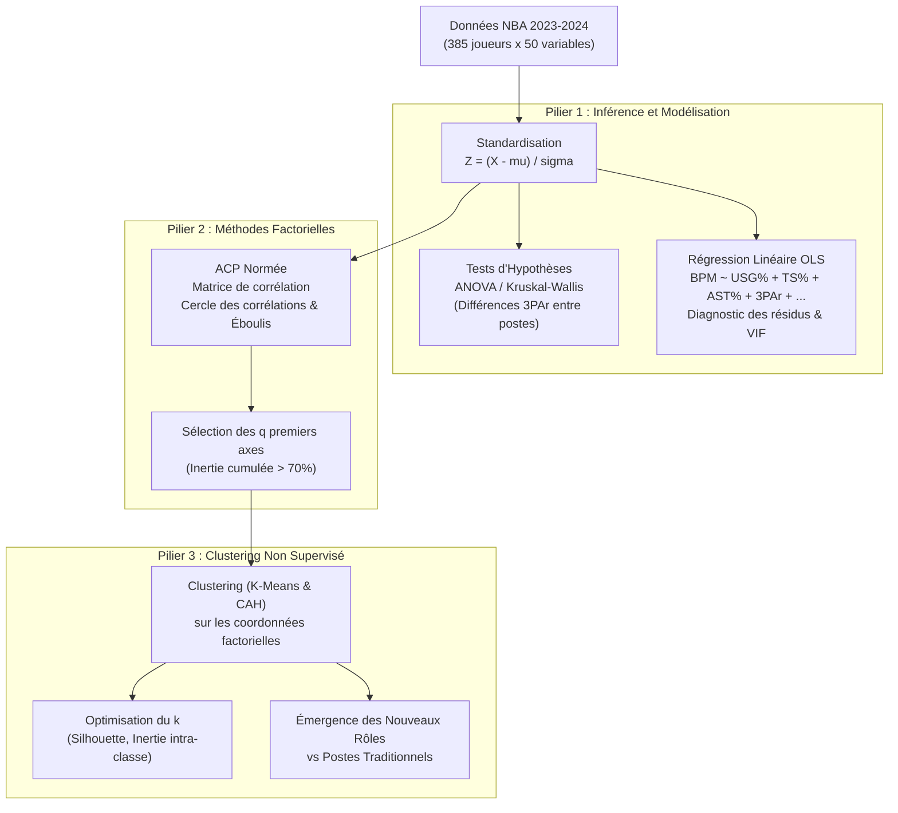

# Projet ANDO 2026 — NBA Analytics & Machine Learning Non Supervisé

> **Thème :** Sport  
> **Sujet :** *« La révolution du tir à 3 points et l'obsolescence des 5 postes traditionnels : Redéfinition des rôles NBA par ACP et Clustering »*  
> **Date de dernière mise à jour :** Novembre 2026  
> **Dossier de travail :** `C:\Users\coren\Desktop\ANDO_TD_TP\Projet`

---

## 1. Contexte Sportif et Problématique

### 1.1 Contexte
Historiquement, la NBA s'est structurée autour de **5 postes rigides** définis principalement par la taille physique et la proximité géographique par rapport au panier :
1. **PG** (*Point Guard* / Meneur) : porteur de balle, distribution du jeu.
2. **SG** (*Shooting Guard* / Arrière) : scoreur extérieur et shooteur.
3. **SF** (*Small Forward* / Ailier) : profil polyvalent extérieur/intérieur.
4. **PF** (*Power Forward* / Ailier fort) : présence physique au rebond et à mi-distance.
5. **C** (*Center* / Pivot) : protection du cercle et rebond sous le panier.

Depuis le milieu des années 2010 (ère du *Moreyball* et avènement des Golden State Warriors), la ligue a basculé vers le paradigme du **"Pace & Space"** : accélération du rythme de possession, maximisation de l'espacement et valorisation de l'efficacité géométrique (tirs primés à 3 points et tirs au cercle au détriment des tirs à mi-distance). 

Aujourd'hui, des pivots mesurant 2m11 mènent l'attaque et tirent à 3 points (Nikola Jokić), tandis que des ailiers défendent sur les 5 postes. **Les 5 étiquettes historiques sont devenues insuffisantes pour décrire la réalité tactique du jeu moderne.**

### 1.2 Problématique centrale
> **« À l'ère du tir à 3 points, dans quelle mesure les 5 postes historiques de la NBA sont-ils devenus obsolètes, et quels nouveaux profils de joueurs émergent lorsque l'on analyse leurs données réelles de jeu ? »**

### 1.3 Sous-questions de recherche (articulées sur les 3 piliers du cours)
1. **Pilier 1 — Inférence & Modélisation** :
   - Les compétences de tir extérieur (`3PAr`) et de création (`AST%`) sont-elles encore ségréguées selon les 5 postes, ou observe-t-on une homogénéisation statistique ?
   - Dans quelle mesure les métriques avancées (volume d'usage, efficacité, création, rebond) permettent-elles de modéliser et prédire l'impact global d'un joueur (`BPM` ou `WS/48`) ?
2. **Pilier 2 — Méthodes Factorielles (ACP)** :
   - Quelles sont les dimensions latentes (axes orthogonaux) structurant l'espace des performances des joueurs NBA ?
   - Retrouve-t-on l'opposition classique "petits extérieurs vs grands intérieurs", ou voit-on émerger des dimensions hybrides (polyvalence, efficacité sans ballon) ?
3. **Pilier 3 — Clustering Non Supervisé** :
   - Combien de profils fonctionnels naturels (clusters) émergent lorsque l'on classifie les joueurs sur leurs coordonnées factorielles ?
   - Ces clusters correspondent-ils aux postes officiels déclarés ou font-ils émerger de nouveaux archétypes modernes (*3-and-D*, *Playmaking Big*, *Primary Scorer*, *Rim Protector*) ?

---

## 2. Le Jeu de Données et Nettoyage

### 2.1 Sources et Extraction
Les données proviennent de **Basketball-Reference** pour la saison régulière complète **2023-2024** :
- **Table Advanced Stats** : métriques de possession normalisées, ratios d'efficacité et d'impact.
- **Table Per Game Stats** : moyennes traditionnelles par match (points, rebonds, passes, tirs).
- Script de collecte automatisé : [`download_and_clean_data.py`](./download_and_clean_data.py)

### 2.2 Protocole de Nettoyage et Pré-traitement
1. **Dédoublonnage des joueurs transférés** : lors d'un transfert en cours de saison, Basketball-Reference produit une ligne pour chaque franchise ainsi qu'une ligne `TOT` (Total). Seule la ligne `TOT` est conservée pour chaque joueur.
2. **Harmonisation des postes** : les désignations composées (ex. `PG-SG`, `SF-PF`) ont été uniformisées sur le poste prédominant.
3. **Traitement des valeurs manquantes** : imputation à $0.0$ pour les pourcentages (`3P%`, `FT%`) chez les joueurs n'ayant tenté aucun tir de la catégorie concernée.
4. **Filtrage de représentativité** : exclusion des joueurs ayant disputé **moins de 400 minutes** sur l'ensemble de la saison. Cela supprime le bruit lié aux joueurs de bout de banc tout en conservant l'intégralité des joueurs réguliers de la rotation.

### 2.3 Échantillon Final
- **Fichier de données nettoyé :** [`nba_2023_2024_cleaned.csv`](./nba_2023_2024_cleaned.csv)
- **Effectif final :** **385 joueurs**
- **Nombre de variables :** **50 colonnes**
- **Répartition par poste officiel :**
  - **SG** (Arrière) : 84 joueurs
  - **SF** (Ailier) : 82 joueurs
  - **PF** (Ailier fort) : 77 joueurs
  - **PG** (Meneur) : 71 joueurs
  - **C** (Pivot) : 71 joueurs

### 2.4 Dictionnaire des Variables Clés Retenues

| Variable | Nom Complet | Formule / Description | Rôle dans l'analyse |
| :--- | :--- | :--- | :--- |
| `Player` | Nom du joueur | Chaîne de caractères unique | Identifiant |
| `Pos` | Poste officiel | PG, SG, SF, PF ou C | Variable qualitative illustrative |
| `Age` | Âge | Âge du joueur au 1er février 2024 | Contrôle |
| `MP` | Minutes jouées | Total de minutes sur la saison ($MP \ge 400$) | Poids / Contrôle |
| `USG%` | Usage Percentage | % de possessions conclues par le joueur quand il est en jeu | Volume de responsabilités |
| `TS%` | True Shooting % | $\frac{\text{PTS}}{2 \times (\text{FGA} + 0.44 \times \text{FTA})}$ (efficacité globale au tir) | Efficacité offensive pure |
| `3PAr` | 3-Point Attempt Rate | $\frac{\text{3PA}}{\text{FGA}}$ (% de tirs pris à 3 points) | Degré d'extériorisation du tir |
| `AST%` | Assist Percentage | % de paniers des coéquipiers assistés par ce joueur | Capacité de playmaking / passe |
| `TRB%` | Total Rebound % | % de rebonds disponibles captés sur le terrain | Impact sous le panier |
| `STL%` | Steal Percentage | % de possessions adverses conclues par une interception | Défense extérieure |
| `BLK%` | Block Percentage | % de tirs à 2 points adverses contrés | Défense intérieure / dissuasion |
| `TOV%` | Turnover % | Pertes de balles pour 100 possessions conclues | Sûreté balle en main |
| `BPM` | Box Plus/Minus | Différentiel de points apporté pour 100 possessions vs joueur moyen | **Variable cible (Impact global)** |
| `WS/48` | Win Shares per 48 min | Victoires estimées générées par 48 minutes de jeu | Variable cible alternative |

---

## 3. Déclinaison des 3 Piliers Méthodologiques ANDO



### Pilier 1 : Inférence Statistique & Modélisation
1. **Tests d'hypothèses sur la distribution du tir extérieur** :
   - Tester si la fréquence de tir à 3 points (`3PAr`) diffère encore significativement selon les postes.
   - Vérification des hypothèses : test de normalité (Shapiro-Wilk) et test d'homoscédasticité (Levene).
   - Application d'une **ANOVA** ou d'un test non-paramétrique de **Kruskal-Wallis**, complété par des tests post-hoc (Tukey HSD / Dunn).
2. **Régression Linéaire Multiple** :
   - Modéliser la contribution d'un joueur :
     $$\text{BPM}_i = \beta_0 + \beta_1 \text{USG\%}_i + \beta_2 \text{TS\%}_i + \beta_3 \text{AST\%}_i + \beta_4 \text{3PAr}_i + \beta_5 \text{TRB\%}_i + \beta_6 \text{STL\%}_i + \beta_7 \text{BLK\%}_i + \varepsilon_i$$
   - Validation des hypothèses du modèle linéaire de Gauss-Markov :
     - Normalité des résidus (QQ-plot, Shapiro-Wilk).
     - Homoscédasticité (test de Breusch-Pagan).
     - Absence de multicollinéarité (calcul du *Variance Inflation Factor* - VIF).
     - Significativité des coefficients (tests de Student sur les $\beta_j$) et test global de Fisher ($F$-test).

### Pilier 2 : Méthode Factorielle (ACP Normée)
1. **Justification de la standardisation** :
   - Les variables possèdent des ordres de grandeur très disparates (les pourcentages d'usage sont $\approx 20\%$, alors que les contres `BLK%` sont $\approx 1.5\%$). Une ACP non centrée-réduite serait écrasée par la variable de plus forte variance brute (cf. TP2).
2. **Sélection du nombre d'axes** :
   - Règle de Kaiser (valeurs propres $\lambda_k > 1$).
   - Graphique de l'éboulis des valeurs propres (*scree plot*) et recherche du coude.
3. **Interprétation des composantes principales** :
   - **Axe 1 (Création extérieure vs Présence intérieure)** : corrélé positivement à `AST%`, `USG%`, `3PAr` et négativement à `TRB%`, `BLK%`.
   - **Axe 2 (Efficacité & Activité sans ballon)** : corrélé à `TS%`, `STL%`, `WS/48`.
   - **Axe 3 (Spécialisation au shoot pur)** : opposant les shooteurs d'appoint aux créateurs sous pression.
4. **Visualisation géométrique** :
   - Cercle des corrélations des variables.
   - Projection des individus (joueurs) dans le premier plan factoriel (PC1, PC2), avec coloration par poste officiel pour mettre en évidence le chevauchement des postes anciens.

### Pilier 3 : Partitionnement (Clustering Non Supervisé)
1. **Entrée du clustering** :
   - Utilisation des coordonnées des joueurs sur les **$q$ composantes retenues de l'ACP** (réduction de dimension et élimination du bruit).
2. **Détermination du nombre de classes $k$** :
   - Méthode du coude (diminution de l'inertie intra-classe / *Within-Cluster Sum of Squares*).
   - Analyse du score de Silhouette moyen pour $k \in [3, 8]$.
   - Dendrogramme de la Classification Ascendante Hiérarchique (CAH) avec critère de Ward.
3. **Identification des archétypes de jeu émergents** :
   - *Cluster A : Primary Playmakers / Ball-Dominant Stars* (Luka Dončić, Trae Young)
   - *Cluster B : 3-and-D Wings / Shooteurs extérieurs* (Klay Thompson, OG Anunoby)
   - *Cluster C : Traditional Rim Protectors / Rebounders* (Rudy Gobert, Clint Capela)
   - *Cluster D : Modern Stretch & Playmaking Bigs* (Nikola Jokić, Kristaps Porzingis)
   - *Cluster E : Bench Scorers / Rôlistes polyvalents*
4. **Validation croisée** :
   - Matrice de contingence croisant les 5 postes officiels et les $k$ clusters obtenus.
   - Calcul de l'Adjusted Rand Index (ARI) pour mesurer l'écart statistique entre les étiquettes historiques et les rôles réels.

---

## 4. Visualisations Réalisées pour le Rapport / Fiche

Ces figures haute définition ont été générées et sont disponibles dans le dossier `Projet/` :

1. **[`eda_correlation_heatmap.png`](./eda_correlation_heatmap.png)** : 
   - Matrice triangulaire de corrélation montrant les fortes liaisons et redondances entre variables.
2. **[`eda_3pt_by_position.png`](./eda_3pt_by_position.png)** : 
   - Boxplot du taux de tirs à 3 points (`3PAr`) par poste, objectivant la diffusion du tir lointain chez les ailiers-forts et pivots.
3. **[`eda_ts_vs_usg.png`](./eda_ts_vs_usg.png)** : 
   - Nuage de points du volume d'utilisation (`USG%`) versus l'efficacité globale (`TS%`), avec annotation des figures majeures de la ligue.

---

## 5. Calendrier Officiel et Livrables

| Livrable | Échéance | Format | Points / Évaluation |
| :--- | :--- | :--- | :--- |
| **Fiche de cadrage intermédiaire** | **Avant le 30 novembre 2026** | Document écrit (2 à 3 pages) | Partie de la note écrite (/7 pts) |
| **Dépôt des slides** | **Avant le 11 décembre 2026** | Présentation (PDF / PPTX) | Validité pour l'oral |
| **Soutenance orale** | **14 décembre 2026** | 15 min présentation + 15 min Q&A | Note orale individuelle (/13 pts) |
| **Rapport final & Code** | **2 semaines après la soutenance** | Rapport complet + scripts reproductibles | Note écrite de groupe (/7 pts) |

---

## 6. Structure des Fichiers du Projet

```text
C:\Users\coren\Desktop\ANDO_TD_TP\Projet\
│
├── download_and_clean_data.py    # Script de téléchargement et nettoyage automatique
├── explore_data.py               # Script d'analyse exploratoire et de génération des figures
│
├── nba_2024_advanced_raw.csv     # Données brutes Advanced de Basketball-Reference
├── nba_2024_per_game_raw.csv     # Données brutes Per Game de Basketball-Reference
├── nba_2023_2024_cleaned.csv     # DATASET FINAL (385 joueurs x 50 variables)
│
├── eda_correlation_heatmap.png   # Figure 1 : Heatmap de corrélations
├── eda_3pt_by_position.png       # Figure 2 : Boxplots 3PAr par poste
├── eda_ts_vs_usg.png             # Figure 3 : Compromis Usage vs Efficacité
│
└── RECAP_PROJET_ANDO.md          # Le présent document récapitulatif
```
